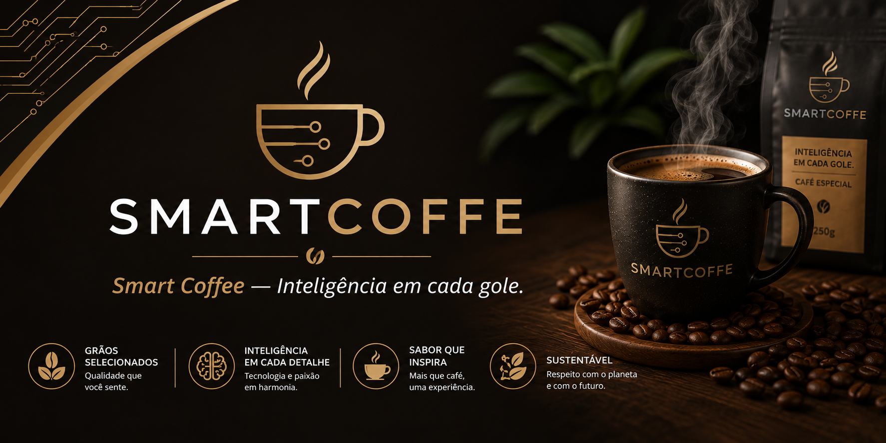

# SmartCoffee

> Café que conecta pessoas.

O **SmartCoffee** é uma landing page responsiva para uma cafeteria fictícia que combina identidade visual acolhedora, apresentação de produtos e uma experiência simples de navegação. O projeto foi desenvolvido como prática de HTML e CSS, trabalhando estrutura semântica, organização de seções, imagens e responsividade.



## Sobre o projeto

A página apresenta a marca SmartCoffee como um espaço moderno para café, conversas e boas ideias. O visitante pode conhecer a proposta da cafeteria, visualizar alguns produtos, explorar o ambiente e encontrar um formulário de contato.

O layout usa uma paleta inspirada em café, com tons de marrom, creme e laranja, além de cartões para os produtos e chamadas de ação distribuídas pela página.

## Seções da página

- **Início:** apresentação da marca e chamada para conhecer o cardápio.
- **Sobre nós:** resumo da proposta da cafeteria.
- **Nossos cafés:** catálogo com café tradicional, latte caramelo e espresso especial.
- **Ambiente:** apresentação do espaço da SmartCoffee.
- **Contato:** formulário para nome, e-mail e mensagem.

## Tecnologias

- HTML5
- CSS3
- CSS Flexbox
- Media queries
- Google Fonts — Inter

## Como executar

O projeto não exige instalação de dependências ou servidor de aplicação. Basta abrir o arquivo [`index.html`](./index.html) em um navegador.

Para executar com um servidor local, na pasta do projeto use:

```bash
python3 -m http.server 8000
```

Depois acesse [http://localhost:8000](http://localhost:8000).

## Estrutura

```text
SmartCoffee/
├── index.html              # Página principal
├── style.css               # Estilos, cores e responsividade
└── IMG/
    ├── ambiente.jpg        # Imagem do espaço
    ├── banner_imagem.png   # Imagem principal do banner
    ├── cafe_caramelo.jpg   # Foto do latte caramelo
    ├── cafe_especial.jpg   # Foto do espresso especial
    ├── cafe_tradicional.jpg# Foto do café tradicional
    └── imagem_sobre.jpg    # Imagem da seção Sobre nós
```

## Observações

O formulário de contato está estruturado visualmente, mas ainda não possui um serviço de envio conectado. Os links de redes sociais no rodapé também funcionam como elementos de navegação visual e podem ser associados aos perfis reais futuramente.

## Autor

Desenvolvido por [Gabriel Lúcio de Araújo](https://github.com/gabrielaraujo-eng).
